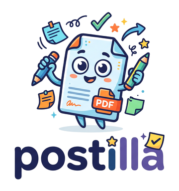
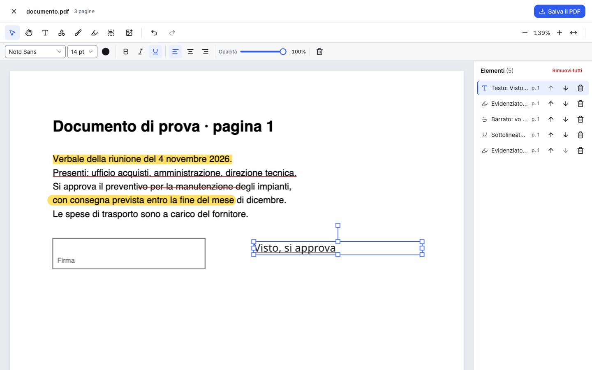
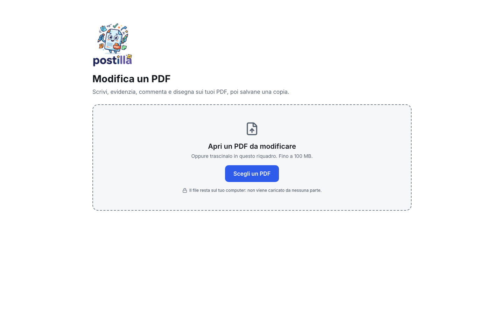
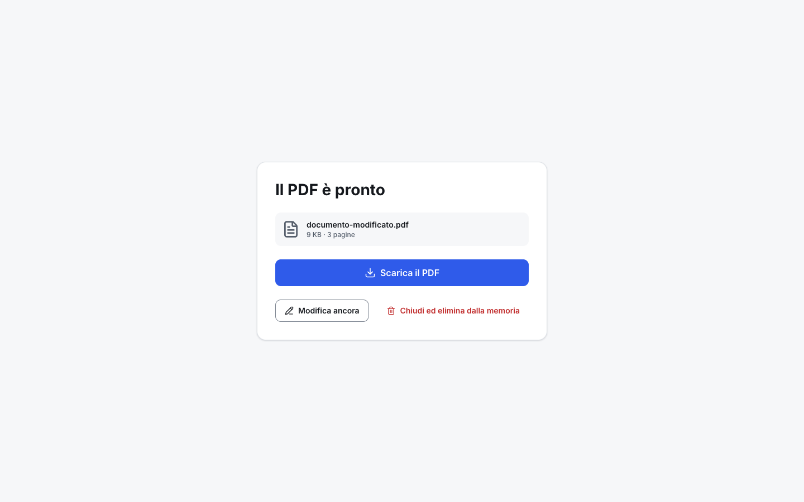

<div align="center">



### L'editor PDF che lavora solo nel tuo browser

Scrivi, evidenzia, commenta e disegna sui PDF, poi salvane una copia.<br />
**Il file non lascia mai il tuo computer.**


</div>



## Indice

- [Perché Postilla](#perché-postilla)
- [Cosa sa fare](#cosa-sa-fare)
- [Avvio rapido](#avvio-rapido)
- [Scorciatoie da tastiera](#scorciatoie-da-tastiera)
- [Comandi](#comandi)
- [Test](#test)
- [Pubblicazione](#pubblicazione)
- [Come funziona](#come-funziona)
- [Struttura del progetto](#struttura-del-progetto)
- [Limiti noti](#limiti-noti)
- [Licenze e crediti](#licenze-e-crediti)

## Perché Postilla

- 🔒 **Riservatezza**: non c'è nessun server. Il PDF si apre, si modifica e si salva dentro il browser; nella versione pubblicata il browser blocca qualsiasi connessione verso altri siti (Content Security Policy).
- 📴 **Funziona senza rete**: una volta aperta la pagina, si continua a lavorare anche se la connessione cade.
- 🧾 **PDF puliti**: evidenziazioni, sottolineature e commenti sono **annotazioni PDF vere**, che si possono rivedere o togliere in Acrobat e negli altri lettori.
- ↩️ **Annulla e Ripeti** su ogni modifica.

## Cosa sa fare

| | |
| --- | --- |
| **Testo** | tre font incorporati (Noto Sans, Serif, Mono), dimensione, colore, grassetto, corsivo, sottolineato, allineamento |
| **Immagini** | PNG e JPG; WebP e GIF convertiti; trasparenza conservata |
| **Forme e disegno** | rettangolo, ellisse, linea; penna; evidenziatore a mano libera che lascia leggibile il testo |
| **Annotare il testo** | evidenzia, sottolinea, sottolinea con onda, barra — trascinando sopra le righe o cliccando una parola |
| **Commenti** | note sulla pagina, lette da tutti i lettori PDF |
| **Gestione** | pannello Elementi con l'ordine dei livelli, opacità, rotazione, copia/incolla anche tra PDF diversi |
| **PDF protetti** | si aprono con la password; il file salvato non è protetto (l'app lo dice) |
| **Pagine difficili** | pagine ruotate, ritagliate, di formati diversi: tutto finisce nel punto giusto |

<table>
  <tr>
    <td width="60%"></td>
    <td width="40%"></td>
  </tr>
  <tr>
    <td align="center"><sub>Apertura del PDF</sub></td>
    <td align="center"><sub>Download</sub></td>
  </tr>
</table>

## Avvio rapido

Serve **Node.js 20** o successivo.

```bash
git clone https://github.com/ChiaCaruso/postilla.git
cd postilla
npm install
npm run dev
```

Apri l'indirizzo che compare nel terminale (di solito `http://localhost:5173`) e scegli un PDF. Per provare senza file tuoi, in `samples/` ci sono PDF di prova: normali, con pagine ruotate, protetti (password `prova`), lunghi, danneggiati.

## Scorciatoie da tastiera

| tasto | azione |
| --- | --- |
| <kbd>V</kbd> | seleziona e sposta |
| <kbd>H</kbd> | mano (trascina per scorrere) |
| <kbd>T</kbd> · <kbd>R</kbd> · <kbd>P</kbd> | testo · forma · penna |
| <kbd>E</kbd> · <kbd>A</kbd> · <kbd>C</kbd> | evidenziatore a mano libera · annota il testo · commento |
| <kbd>I</kbd> | inserisci immagine |
| <kbd>Invio</kbd> su Testo, Forma o Commento | inserisce al centro della pagina, senza mouse |
| <kbd>Ctrl</kbd> <kbd>Z</kbd> · <kbd>Ctrl</kbd> <kbd>Maiusc</kbd> <kbd>Z</kbd> / <kbd>Ctrl</kbd> <kbd>Y</kbd> | annulla · ripeti |
| <kbd>Ctrl</kbd> <kbd>C</kbd> · <kbd>Ctrl</kbd> <kbd>V</kbd> | copia · incolla l'elemento |
| <kbd>Canc</kbd> | elimina l'elemento selezionato |
| frecce · <kbd>Maiusc</kbd> + frecce | sposta di 1 pt · di 10 pt |
| <kbd>Ctrl</kbd> <kbd>+</kbd> · <kbd>Ctrl</kbd> <kbd>−</kbd> | zoom |
| <kbd>Esc</kbd> | esci dalla scrittura / deseleziona |

Su Mac, <kbd>Cmd</kbd> al posto di <kbd>Ctrl</kbd>.

## Comandi

| comando | cosa fa |
| --- | --- |
| `npm run dev` | server di sviluppo; la pagina dei componenti è su `/design.html` |
| `npm test` | test end-to-end con Playwright (avvia da solo il server) |
| `npm run build` | controllo dei tipi e build di produzione in `dist/` |
| `npm run preview` | serve localmente la build di produzione |
| `npm run lint` | controllo del codice (oxlint) |
| `npm run samples` | rigenera i PDF di prova in `samples/` |
| `npm run tokens` | rigenera i colori e le misure (`src/styles/tokens.css`) da `docs/design/tokens.json` |
| `python3 scripts/brand-assets.py` | rigenera logo e icone da `brand/postilla-logo-sorgente.jpg` (serve Pillow) |

## Test

```bash
npx playwright install chromium   # la prima volta
npm test
```

75 test end-to-end su tutti i flussi: apertura (anche protetti, danneggiati, oltre 100 MB, trascinamento), testo, immagini, forme, annotazioni, commenti, annulla, copia/incolla, mano, senza rete, larghezza mobile.
Ogni test fallisce anche se compare un errore in console, e le schermate principali passano un controllo di accessibilità (axe).

Diversi test **confrontano l'editor con il PDF esportato**: salvano, riaprono il file e verificano che testo, forme e annotazioni siano nello stesso punto, anche su pagine ruotate.

Il report HTML dell'ultima esecuzione finisce in `e2e-report/`.

## Pubblicazione

```bash
npm run build
```

`dist/` contiene solo file statici: va bene qualsiasi server web, anche interno, oppure servizi come Netlify o Vercel (con accesso protetto se lo strumento è solo per il team). Nessun server applicativo, nessun database, nessuna variabile d'ambiente.

La build inserisce già nella pagina una Content Security Policy che consente solo risorse dello stesso sito. Se il server aggiunge una propria intestazione `Content-Security-Policy`, deve permettere anche `'wasm-unsafe-eval'` per gli script e `blob:` per worker e immagini.

## Come funziona

```
PDF scelto ──► pdf.js ──────────► pagine disegnate (sfondo del canvas)
                │                           │
                └─ testo della pagina ──┐   ▼
                                        ├► Fabric.js: testo, immagini, forme, annotazioni
   stato (Zustand, con Annulla) ◄───────┘   │
                │                           ▼
                └───────────────► pdf-lib: un solo passaggio dalle coordinate
                                  "come si vede" a quelle del PDF ──► copia scaricata
```

- **pdf.js** mostra le pagine e legge il testo (per evidenziare e sottolineare).
- **Fabric.js** è il livello modificabile sopra ogni pagina; la pagina stessa ne è lo sfondo, così l'evidenziatore si fonde con il testo come nel PDF.
- **@cantoo/pdf-lib** scrive il PDF finale: disegna gli elementi, incorpora i font (solo i caratteri usati), crea le annotazioni vere, decifra i PDF protetti.
- Tutte le coordinate sono in punti PDF; la conversione per pagine ruotate o ritagliate avviene in un solo posto (`src/pdf/export.ts`).

## Struttura del progetto

```
src/
  pdf/        apertura, esportazione, font, geometria, testo della pagina
  editor/     pagina modificabile (Fabric.js), barra delle proprietà, nuovi elementi
  screens/    caricamento, editor, elaborazione, download
  ui/         componenti dell'interfaccia (solo colori e misure dei token)
  model.ts    modello dei dati · store.ts stato e cronologia di Annulla
e2e/          test Playwright
samples/      PDF di prova (rigenerabili)
scripts/      font, risorse di pdf.js, token, PDF di prova, logo e icone
brand/        logo sorgente
public/       font incorporabili, logo, icone
docs/      design (token e componenti) e screenshot
```

## Limiti noti

- Non modifica il testo **già presente** nel PDF (si può coprire e riscrivere sopra).
- Si annota solo il testo **orizzontale**; sul testo ruotato l'app lo dice e propone l'evidenziatore a mano libera.
- Emoji e alcuni simboli non entrano nel PDF: l'editor li elenca prima del salvataggio.
- File fino a **100 MB**; con file molto grandi il salvataggio può bloccare la pagina per qualche secondo.
- Senza rete, i PDF che usano font non incorporati possono apparire con un font sostitutivo.


## Licenze e crediti

Codice dell'app: uso interno.

| componente | licenza |
| --- | --- |
| [pdf.js](https://github.com/mozilla/pdf.js) | Apache-2.0 |
| [@cantoo/pdf-lib](https://github.com/cantoo-scribe/pdf-lib), [@cantoo/fontkit](https://github.com/cantoo-scribe/fontkit) | MIT |
| [Fabric.js](https://github.com/fabricjs/fabric.js) | MIT |
| React, Zustand, Radix UI | MIT |
| [Lucide](https://lucide.dev) (icone) | ISC |
| Font Noto e Inter | SIL Open Font License (`public/fonts/OFL.txt`) |
